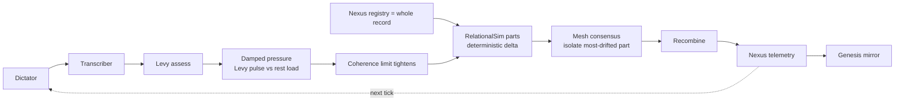

# Oroboro Relay – Resilient ATC Companion

## Concept
“We have an app for that.”

Oroboro Relay applies the Oroboro state-reduction and relational simulation framework to the exact failure mode that grounded U.S. flights on 13 November 2026: a single remote router flood cascading into inconsistent radar and voice data across the national ATC network.

Instead of requiring the entire centralized system to be perfect, the app treats each Air Route Traffic Control Center (and its neighboring sectors) as an independent part. Local state continues. Deltas are reconciled when links return. The observable traffic picture remains coherent with what a whole-system process would have produced.

## Core Features Demonstrated
- **Independent Sector Processing** — Each center maintains its own reduced state.
- **Mesh Status & Isolation** — Degraded nodes can be isolated; others continue.
- **Delta Reconciliation** — One-click recombine that restores observable equivalence.
- **Oroboro Dictator** — Live transcription chronicle of voice communications.
- **Levy Weight** — Critical messages accumulate measurable weight for prioritization and audit.
- **Nexus Telemetry** — Registry, archive, and live broadcast of sector metrics.

## Conjunctive pipeline (27 Nov 2026)
`oroboro-core.js` now runs every component in one loop through `OroboroPipeline`:

- **Fixed:** delta reconciliation was `Math.random() * 0.1`. It is now deterministic: a part's local copy is compared with the Nexus record (relative flight gap, plus 0.1 if the status disagrees). The Swift app (`swift/.../OroboroRelayApp.swift`) uses the same rule in place of `Double.random`.
- Tests: `node tests/pipeline.test.js` (determinism, Levy from Transcriber entries, pressure tightening the limit, drifted-part isolation, zero delta when the copies match).
- `metastasis-sim/index.html` is a **superseded** visual sketch (Math.random, log-line reconcile). The native, integrated model is [Oroboro/research/metastasis-native](https://github.com/caitlynrandels-del/Oroboro/tree/main/research/metastasis-native). Speculative modeling only; no clinical claims.

## How It Maps to the Crisis
The 13 Nov 2026 event was caused by legacy switches/routers (some 2001-era) becoming overloaded during an L3Harris copper-to-fiber upgrade at a remote site. Inconsistent data forced a nationwide ground stop.

Oroboro Relay would have:
1. Detected the flood as a local delta spike.
2. Isolated the affected remote node while neighboring sectors continued independent processing.
3. Maintained a reconciled traffic picture from the remaining coherent parts.
4. Preserved a full transcript and levy-weighted chronicle for post-event analysis.

## Files
- `index.html` — Self-contained interactive prototype (open in any browser).
- `oroboro-core.js` — Core classes (Nexus, Transcriber, Dictator, Levy, Genesis, RelationalSim) plus `OroboroPipeline` (conjunctive loop); deterministic delta.
- `tests/pipeline.test.js` — Node tests for the pipeline.
- `OroboroRelayVisionOS.swift` — Early VisionOS / SwiftUI sketch.
- `swift/` — **Full native SwiftUI conversion** for VisionOS, iOS, and macOS (open `swift/Package.swift` in Xcode).
- `UPDATE-ALL-2026-11-14.md` — Update log.
- `metastasis-sim/` — Interactive metastasis heat-trace sketch (superseded; see above).

Open `index.html` to interact with the web prototype, or open the `swift` folder in Xcode for the native Apple app.

## Related Work
- Main framework: [Oroboro](https://github.com/caitlynrandels-del/Oroboro)
- **Metastatic Cascade Analysis** — Identifiability limits of stage-specific control in a calibrated stochastic model (1.21-million-run study with dose-response, onset-timing, and explicit study-design limitations): https://github.com/caitlynrandels-del/metastatic-cascade-analysis

See also the main [Oroboro](https://github.com/caitlynrandels-del/Oroboro) repository.
